  

 

Estudio **Ingeniería en Realidad Virtual y Diseño de Juegos Digitales** en la Universidad Bernardo O'Higgins. Hago videojuegos y experiencias interactivas en tiempo real, principalmente en **Unreal Engine** (C++ y Blueprints) y **Unity** (C#).

Me interesa usar el cuerpo como forma de controlar un juego, así que gran parte de lo que hago mezcla software con hardware: **EEG, Arduino, chalecos hápticos y sensores de bioseñales**. También estoy aprendiendo Virtual Production y el pipeline de MetaHuman en Unreal 5.

> Ahora mismo estoy desarrollando **EEGame**, mi proyecto de título: un videojuego que se controla con un casco EEG. También estoy buscando mi **primera práctica profesional**.

 

### Proyectos

<table>
  <tr>
    <td width="50%" valign="top">
      <a href="https://github.com/Latshir110/Candy-Sensors"><b>Candy Sensors</b></a> 
      Unreal Engine 5.5 · Arduino · Blueprints
      
Prototipo de comunicación serial entre Arduino y Unreal Engine con el plugin SerialCOM. Botones y sensores físicos controlan elementos del juego en tiempo real.

    </td>
    <td width="50%" valign="top">
      <b>EEGame</b> (en desarrollo) 
      Unity · C# · Emotiv EPOC X
      
Proyecto de título. Videojuego controlado con electroencefalograma, no invasivo y pensado para que lo pueda usar más de una persona.

    </td>
  </tr>
  <tr>
    <td width="50%" valign="top">
      <a href="https://github.com/Latshir110/Kristal_PortafolioActualizado"><b>Portafolio</b></a> 
      Angular · Django REST Framework
      
Mi portafolio personal con blog, frontend en Angular y API en Django.

    </td>
    <td width="50%" valign="top">
      <b>Avatares no antropomórficos</b> 
      Investigación · UCL · Université PSL
      
Prototipo de videojuego con chaleco háptico y estimulación muscular eléctrica, desarrollado como asistente de investigación.

    </td>
  </tr>
</table>

 

### Experiencia

**Asistente de investigación** · Universidad Bernardo O'Higgins 
Diciembre 2024 – Febrero 2025

Investigación sobre avatares no antropomórficos con hápticas, en colaboración con University College London (Knowledge Lab) y Université PSL (Spatial Media). Desarrollé y probé un prototipo de videojuego con chaleco háptico, investigué sensores para el proyecto y apoyé la recopilación y el análisis de datos de biofeedback.

**Representante estudiantil, Comité Curricular** · Universidad Bernardo O'Higgins 
Abril 2026 – Diciembre 2026

 

### Reconocimientos

| | |
|---|---|
| **Segundo lugar**, Game Jam Social Impact Game | Ministerio de Educación · 2024 |
| **Ponencia** "Videojuegos biónicos, explorando nuevas interfaces entre cuerpo y máquina" | III Congreso de Diseño de Juegos Digitales, U. Andrés Bello · 2025 |
| **MetaHuman Pipeline**, introducción a Unreal Engine 5.6 | Universidad Bernardo O'Higgins · 2026 |
| **Masterclass Virtual Production ICVFX** | Madis Films |
| **Academia de Liderazgo** | Universidad Bernardo O'Higgins · 2024 |

 

### Herramientas

  
  
  
  
  
  
  
  
  
  
  
  
  
  
  

Inglés B2 (Oxford Placement Test)

 

### Contacto

[kristalesperanzaespinoza@gmail.com](mailto:kristalesperanzaespinoza@gmail.com) · [Portafolio web](https://protafolio-kristal-espinoza.vercel.app)
